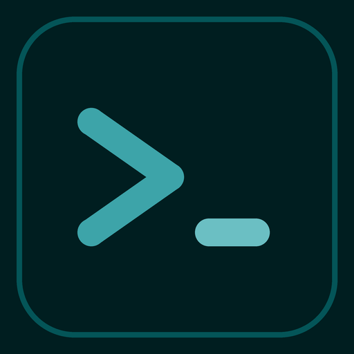

<p align="center">
  
</p>

# TERM-LM

**The terminal runtime your coding agents live on.** A Husaini Holding product.

TERM-LM is a terminal workspace manager for AI coding agents. It keeps workspaces, tabs, and panes
running in a background server, detects what each agent is doing, and lets agents drive the
terminal through a CLI and socket API.

## Install

Build from source (Rust toolchain from `rust-toolchain.toml`, plus Zig 0.16.0 for the vendored libghostty-vt):

```bash
cargo build --release
./target/release/term-lm
```

Prebuilt binaries are not published yet.

## Develop

```bash
just test    # nextest + maintenance tests
just check   # formatting, lint, tests
```

See `AGENTS.md` for architecture rules and `CONTRIBUTING.md` for contribution notes.

## License

Apache-2.0. See `LICENSE` and `NOTICE`.
